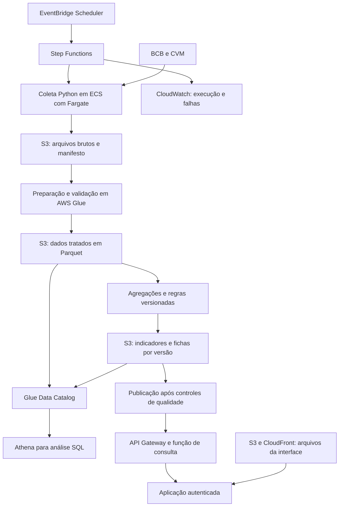

# Radar Setorial-Territorial PJ: proposta de evolução na AWS

Status: arquitetura proposta para discussão no case. Nenhum recurso AWS foi provisionado. O desenho não representa uma descrição dos sistemas internos do Itaú.

## 1. Objetivo da evolução

O MVP comprovará a utilidade do radar com uma coleta reproduzível e um HTML portátil. A evolução na AWS deverá permitir atualização agendada, armazenamento de versões, processamento controlado, acesso SQL e distribuição dos resultados aos analistas.

Os requisitos que justificam a evolução são:

- Repetir a coleta sem depender da máquina do analista.
- Identificar origem, competência e versão de cada resultado.
- Impedir que uma execução com problemas substitua o último resultado válido.
- Incorporar reapresentações e revisões das fontes.
- Separar dados públicos da futura integração com uma carteira interna.
- Controlar acesso, registrar falhas e medir custo e tempo de execução.

O padrão inicial será processamento em lote. A frequência deverá acompanhar a publicação das fontes e a utilidade para o negócio. Não há requisito demonstrado de streaming no case.

## 2. Visão geral



O diagrama mostra responsabilidades lógicas. A implementação inicial pode executar preparação e agregação no mesmo contêiner Python, mantendo os formatos e contratos de dados. A migração desses estágios para Glue será decidida pelo perfil de processamento, tamanho da base e padrão da plataforma adotada pela organização.

## 3. Componentes e justificativas

| Componente | Responsabilidade no radar | Decisão que o candidato deve explicar |
|---|---|---|
| EventBridge Scheduler | Agendar a execução do fluxo | A frequência deve acompanhar disponibilidade da fonte e necessidade da área |
| Step Functions | Coordenar etapas, tentativas, falhas e publicação | Cada etapa terá estado e resultado verificáveis |
| ECS com Fargate | Executar o coletor Python em contêiner | O perfil de download, descompactação e processamento será medido antes do dimensionamento |
| S3, camada bruta | Preservar arquivos recebidos e metadados de coleta | Reprocessamento precisa partir de uma versão conhecida da fonte |
| AWS Glue ETL | Preparar dados e executar transformações quando apropriado ao volume | O código e os esquemas do MVP devem ser reaproveitáveis |
| S3, camada tratada | Armazenar dados tipados e padronizados | Parquet e particionamento serão avaliados pelo padrão de consulta |
| S3, camada analítica | Armazenar indicadores, referências e fichas por versão | O produto precisa consumir resultados consistentes e identificáveis |
| Glue Data Catalog | Registrar tabelas, colunas e partições | O catálogo descreve os dados, enquanto o S3 os armazena |
| Athena | Permitir consultas SQL e investigação dos analistas | Consultas sobre dados tratados devem preservar regras e definições comuns |
| API Gateway e função de consulta | Entregar resultados pré-calculados à aplicação | A navegação comum não precisa disparar uma nova consulta ampla no Athena |
| S3 e CloudFront | Distribuir os arquivos estáticos da interface | Conteúdo da aplicação e dados restritos têm formas de entrega distintas |
| CloudWatch | Registrar logs, duração e resultados de execução | Uma falha deve ser identificável e investigável |

O Step Functions possui integração documentada para executar e acompanhar tarefas ECS/Fargate. [Documentação oficial](https://docs.aws.amazon.com/step-functions/latest/dg/connect-ecs.html).

O Athena utiliza o Glue Data Catalog para metadados de dados armazenados no S3. [Documentação oficial](https://docs.aws.amazon.com/athena/latest/ug/data-sources-glue.html).

O Glue pode trabalhar com arquivos em S3 e formatos como CSV, JSON e Parquet. [Documentação oficial](https://docs.aws.amazon.com/glue/latest/dg/edit-jobs-source-s3-files.html).

## 4. Organização dos dados

### Camada bruta

Preservar o arquivo oficial recebido. Para cada coleta, registrar URL, fonte, data e hora, tamanho, hash e identificador da execução. O arquivo original é a evidência do que estava disponível naquela coleta.

Exemplo lógico de organização:

```text
raw/fonte=bcb/coleta=AAAA-MM-DD/arquivo_original.zip
raw/fonte=cvm/coleta=AAAA-MM-DD/arquivo_original.csv
metadata/execucao=IDENTIFICADOR/manifesto.json
```

### Camada tratada

Padronizar datas, códigos, tipos numéricos, nomes de dimensões e entidades. Manter os saldos necessários para recalcular as razões. Registrar o vínculo entre companhia, documentos consultados e enquadramento no grupo de comparação.

As dimensões de referência incluem período, UF, seção CNAE e porte do comparador. A dimensão de companhia real terá atributos documentados e a origem do mapeamento. A identificação da empresa não cria informação individual de crédito no SCR.data público.

### Camada analítica

Produzir os indicadores do radar, suas referências nacionais, as sinalizações e os dados das fichas. Cada publicação terá:

- Identificador e data da publicação.
- Competência disponível em cada fonte.
- Versão dos dados de entrada.
- Versão do código e dos parâmetros de sinalização.
- Resultado dos controles de qualidade.

Os produtos analíticos ficam vinculados a uma versão. A aplicação consulta a última versão aprovada pelo processo de qualidade.

## 5. Fluxo de execução

1. Iniciar uma execução com identificador único.
2. Verificar disponibilidade das fontes e obter os arquivos necessários.
3. Gravar o snapshot bruto e o manifesto.
4. Validar esquema e conteúdo antes do tratamento.
5. Padronizar, filtrar PJ e agregar numeradores e denominadores.
6. Calcular indicadores e comparações com filtros compatíveis.
7. Atualizar os atributos públicos da amostra de empresas e seus vínculos de comparação.
8. Executar os controles de qualidade e produzir o relatório.
9. Gravar uma nova versão dos resultados analíticos.
10. Atualizar a referência da última publicação válida somente após sucesso.

O fluxo deve ser idempotente: repetir a execução sobre a mesma entrada e mesma configuração deve produzir o mesmo conteúdo analítico, sem duplicar registros.

O SCR.data distribui arquivos anuais contendo competências mensais. A estratégia de atualização deve considerar esse formato. Depois de receber uma nova versão do arquivo, o processamento identifica novas competências e revisões. Não se deve presumir que exista um endpoint incremental por mês.

## 6. Qualidade, revisão e falhas

Controles mínimos propostos:

- Campos obrigatórios e tipos esperados.
- Competências válidas e ausência de duplicação na granularidade final.
- Integridade dos códigos territoriais e das categorias.
- Soma dos saldos e consistência dos denominadores.
- Razões e variações examinadas dentro de seus significados econômicos.
- Ausência de dados distinguida de zero.
- Cobertura mínima para sinalizar um recorte.
- Cadastro da empresa e mapeamento para o comparador com procedência.
- Comparação de totais e contagens com a publicação anterior para detectar mudanças inesperadas.

Se houver indisponibilidade temporária da fonte, aplicar tentativas limitadas e registrar a falha. Se houver quebra de esquema ou inconsistência material, suspender a publicação daquela execução. A interface continua mostrando a versão válida anterior e sua competência.

Reprocessamentos devem indicar quais competências foram substituídas e qual versão gerou a alteração. Um histórico de versões também ajuda a estudar como revisões das fontes afetaram resultados anteriores.

## 7. Acesso e integração com a área

No case público, os dados utilizados serão públicos e documentados. Uma futura implantação interna poderá integrar CNPJ, classificação de carteira, exposição, estágio do caso e outras informações autorizadas. Esses campos ficam em ambiente restrito.

A aplicação corporativa deverá usar autenticação federada com o provedor da organização e autorização na API. O desenho exato depende dos padrões existentes. O HTML público e portátil do MVP não será usado como mecanismo para distribuir dados de clientes internos.

IAM define permissões dos serviços. Criptografia e políticas de acesso protegem os objetos. CloudWatch registra operação e CloudTrail pode registrar eventos de auditoria conforme a configuração adotada. Lake Formation é uma opção para governar permissões de tabelas e acesso analítico quando houver necessidade de perfis mais detalhados.

Lake Formation e IAM atuam de forma complementar no acesso via Athena. [Documentação oficial](https://docs.aws.amazon.com/athena/latest/ug/lf-athena-user-permissions.html).

## 8. Consulta e desempenho

Para os filtros comuns do radar, usar indicadores pré-calculados e respostas pequenas. O Athena ficará disponível para exploração SQL, conferência e análises adicionais. Essa separação evita acoplar cada interação da tela a uma consulta ampla sobre os arquivos.

Particionar os dados conforme filtros e volume efetivamente observados. Não criar muitas partições ou arquivos pequenos apenas para reproduzir um padrão de arquitetura. Medir tempo de resposta, quantidade de dados lidos e tamanho dos resultados.

## 9. Custos e implantação

Os principais fatores de custo serão armazenamento e retenção, tempo de processamento, frequência das execuções, dados lidos nas consultas, logs e tráfego da aplicação. A estimativa deverá usar volume e frequência medidos, região escolhida e preços vigentes. Este documento não apresenta um valor financeiro sem esses parâmetros.

Uma implantação gradual pode seguir esta ordem:

1. Empacotar o código local em contêiner e externalizar configuração.
2. Armazenar entradas e saídas no S3 com manifesto e versionamento definido.
3. Orquestrar a execução e as verificações.
4. Catalogar as tabelas e disponibilizar consultas SQL.
5. Publicar a aplicação autenticada sobre a API de resultados.
6. Integrar, em ambiente restrito, a carteira interna autorizada.
7. Revisar o motor de processamento e os controles conforme uso e escala.

Infraestrutura como código e configuração versionada devem acompanhar a implantação. O case deve mostrar quais partes já funcionam no MVP e quais dependem de implantação na nuvem.

## 10. Argumentos para a apresentação

**O que torna essa evolução moderna?** A atualização deixa de depender da execução manual, os resultados têm origem e versão identificáveis, a qualidade controla a publicação e os serviços assumem responsabilidades claras.

**Por que preservar o MVP local?** Ele demonstra a utilidade analítica e mantém uma forma portátil de reprodução. O núcleo de regras e cálculos será reaproveitado na evolução.

**Por que Fargate e Glue aparecem no desenho?** A coleta de arquivos e a transformação dos dados têm perfis distintos. O desenho separa essas responsabilidades, mas admite um primeiro estágio de nuvem com o mesmo contêiner Python quando o volume permitir. A escolha final exige medir a carga.

**Por que não atualizar a cada segundo?** A necessidade inicial acompanha fontes periódicas e revisões de análise. A frequência será escolhida pelo momento em que novos dados podem alterar uma decisão.

**O que acontece quando a execução falha?** A publicação anterior permanece disponível com sua competência. A execução falha deixa registro e pode ser repetida ou corrigida sem alterar silenciosamente os resultados em uso.

**Isso já está implantado na AWS?** Não. O case apresenta uma demo local executável e uma proposta documentada de evolução, com um caminho de migração verificável.
