# Assets para a apresentação

13 imagens PNG, **1920 × 1080, proporção 16:9**, prontas para inserir no PowerPoint. Numeração indica uma sequência sugerida; use as imagens que ajudarem sua narrativa.

- **01–06:** visualizações didáticas do processo implementado, construídas com fontes, valores e resultados reais. Não são prints de Excel, terminal ou sistema de produção do banco.
- **07–13:** capturas da interface implementada no Edge, com os filtros aplicados. O DOM renderizado foi congelado apenas para estabilizar a captura; dados, textos e código do produto foram preservados.
- Exemplo principal: comércio/SP, médias e grandes, agosto de 2026. A consulta individual usa Magazine Luiza como companhia pública de exemplo, sem atribuir vínculo com o banco, inadimplência ou situação de recuperação.

O Computer Use solicitado falhou ao inicializar a sessão (`failed to write kernel assets`, os error 3), mesmo após reset. As imagens foram produzidas com o Microsoft Edge instalado, em modo headless, sem borda do navegador.

## Como usar no PowerPoint

Abra a imagem no GitHub e use **Download raw file / Baixar arquivo bruto** para obter o PNG original. No PowerPoint, use **Inserir → Imagens → Este dispositivo**. Evite copiar a miniatura do GitHub, pois ela pode ter resolução menor. Preserve a proporção da imagem.

As telas completas permitem recortes no próprio PowerPoint. Nas imagens de empresa, preserve a identificação da companhia e a indicação de que os sinais pertencem ao grupo. Na imagem de IA, preserve “Integração futura” e “Nenhum parecer foi gerado”.

## Índice e mensagens para os slides

| Filename | Título do slide | Mensagem para apresentar | Limite essencial a preservar |
|---|---|---|---|
| [01_fluxo_dados.png](01_fluxo_dados.png) | Do arquivo público à pergunta de análise | “O Python filtra e agrega os CSVs públicos. O HTML recebe os saldos tratados e calcula os indicadores conforme os filtros.” Fluxo real: BCB → ZIP anual → CSVs mensais → Python → `scr_agregado.csv` e `radar.json` → build → HTML. A CVM é uma trilha própria de cadastro e demonstrativos por companhia. | Abertura e filtros do HTML usam um snapshot local; não consultam nem atualizam o BCB. SCR público não contém CNPJ. Não desenhar ligação de SCR a uma empresa como identificação individual. |
| [02_csv_original.png](02_csv_original.png) | Uma linha representa um grupo publicado | “O BCB já publica combinações de data, UF, cliente, atividade, porte e outras dimensões. Este trecho mostra linhas reais de comércio/SP em agosto de 2026.” As duas primeiras linhas do exemplo têm carteira ativa de R$ 3.819.589,22 e R$ 4.085.405,34. | Não é uma linha por contrato ou empresa. Se colunas ou descrições forem abreviadas, escrever “colunas selecionadas; descrições abreviadas”; não chamar o trecho editado de CSV integral. |
| [03_padronizacao.png](03_padronizacao.png) | Padronizar antes de somar | “Mantive PJ, transformei a data em competência, associei comércio à seção G, padronizei o porte e converti os sete saldos em centavos inteiros.” Exemplo: `3819589,22` → `381958922` centavos; `Médio` → `medio`; chave final: mês × UF × seção × porte. | Segmento, modalidade, submodalidade, origem e indexador são somados na chave final. `numero_de_operacoes = -1` significa contagem suprimida; não zera os saldos e não é somado pelo radar. |
| [04_agregacao.png](04_agregacao.png) | Comércio/SP: 428 linhas viram dois agregados | “No recorte PJ de comércio/SP, as 239 linhas de porte médio e 189 de porte grande viram dois registros. Somar esses dois saldos preserva o peso de cada carteira.” Resultado: ativa de R$ 111.899.626.955,73; inadimplente de R$ 4.999.484.596,98. | 428 é o recorte de agosto/SP/médias e grandes, dentro das 313.138 linhas mensais; não é a base completa. O processamento completo publicou 53.100 agregados em 20 competências. |
| [05_calculo_gatilho.png](05_calculo_gatilho.png) | Da soma de saldos ao sinal descritivo | “A razão dos saldos resulta em 4,47%. Contra maio, a alta é de 0,64 p.p.; contra o mesmo setor no Brasil, a diferença é de 0,06 p.p. O primeiro critério aciona ‘Deterioração recente’.” Fórmula: R$ 4.999.484.596,98 ÷ R$ 111.899.626.955,73 × 100. | Não fazer média simples de taxas. O Brasil inclui SP. Os limiares de 0,5 e 1 p.p. são demonstrativos; o piso de R$ 100 mi e quatro competências contínuas são atendidos. O sinal pertence ao grupo. |
| [06_validacao.png](06_validacao.png) | Evidência que pode ser conferida | “O snapshot registra 18 verificações de integridade e cobertura aprovadas. O exercício de comércio/SP também reconciliou os dois agregados de agosto com o bruto. Há dez reconciliações Decimal preservadas da etapa original, com diferença máxima de R$ 0,00 nos sete saldos verificados.” | Identificar evidências salvas e o seu escopo. As dez reconciliações originais não foram refeitas na ampliação CVM; `validacao.json` atual tem `independent_raw_audits: []`. ‘Aprovado’ refere-se às verificações técnicas; não equivale a homologação do banco, auditoria externa, acurácia preditiva ou retorno financeiro. |
| [07_panorama.png](07_panorama.png) | Localizar mudanças que merecem revisão | “A matriz cruza atividade e UF da sede; a taxa é exibida na célula e a cor mostra quais critérios foram atingidos. O panorama organiza os recortes para investigar.” Para ago/26, médias e grandes e regras padrão: 167 de 393 recortes elegíveis com algum gatilho; 61 com dois sinais. | Ordenação descritiva por sinais e variação; não é ranking de risco individual. ‘Sem gatilho’ não comprova baixo risco. Os números variam com competência, porte e parâmetros. |
| [08_detalhe_comercio_sp.png](08_detalhe_comercio_sp.png) | Conferir o sinal antes de interpretar | “Comércio/SP combina alta recente de 0,64 p.p. com diferença pequena de 0,06 p.p. para o Brasil. A tela permite conferir histórico, referência, numerador e denominador antes de formular uma pergunta.” | O padrão não prova causa paulista nem piora de uma companhia. UF representa sede; carteira e estrutura de vencimentos são do grupo. A referência nacional inclui SP. |
| [09_gatilhos.png](09_gatilhos.png) | Tornar os critérios transparentes | “Os critérios podem ser alterados: alta de 0,5 p.p. em três meses, diferença de 1 p.p. para o Brasil e piso de R$ 100 mi. A classificação exige quatro competências contínuas com saldo positivo.” | Mostrar os valores realmente selecionados na captura. Ajustar parâmetros revela sensibilidade da seleção; não demonstra maior acerto. O piso é materialidade financeira, não tamanho estatístico da amostra. |
| [10_busca_companhias.png](10_busca_companhias.png) | Do contexto à consulta por companhia | “A busca por nome, CNPJ ou setor acessa os 660 CNPJs ativos do snapshot e permite filtrar cobertura financeira e enquadramento. O cadastro mantém visíveis também as lacunas.” | 660 consultáveis não significa 660 fichas completas: 592 padronizadas, 48 especializadas e 20 sem demonstrativo. Comparadores: 12 editoriais com revisão, 491 propostas a validar e 157 sem enquadramento. Não são clientes nem carteira do banco. |
| [11_ficha_empresa.png](11_ficha_empresa.png) | A ficha conecta fontes e prepara uma pergunta | Preferência: **Magazine Luiza**, para continuar o mesmo grupo comércio/SP. “Confiro atividade, sede, enquadramento, documentos e contas próprias. Depois pergunto se a geração de caixa acompanha estoques e recebíveis e se a renovação de linhas está nas projeções.” Alternativa: Tupy, com perguntas sobre pedidos, operações fora da UF e vencimentos. | Separar visualmente os indicadores do grupo dos demonstrativos da companhia. Enquadramento é editorial, não CNAE confirmado. Porte é filtro do comparador. Datas CVM são próprias; escolher um mês SCR antigo não reconstrói a ficha conhecida naquele mês. Nenhuma companhia foi associada à carteira do banco. |
| [12_ia_futura.png](12_ia_futura.png) | Preparar contexto para uma integração futura | “A ficha já organiza fatos, filtros, fontes e lacunas, e pode ser copiada ou exportada em JSON. Uma IA interna autorizada poderia usá-la para elaborar uma síntese preliminar, evidências e perguntas para revisão humana.” | Manter visíveis “Integração futura” e “Nenhum parecer foi gerado”. A demo não chama modelo nem envia a ficha a um modelo. Não inserir parecer simulado ou sugerir integração implantada. |
| [13_metodologia.png](13_metodologia.png) | Deixar cálculo, procedência e limites acessíveis | “A metodologia explicita as razões de saldos, os gatilhos e as fontes. O pacote processou 6.276.330 linhas, reteve 2.557.914 PJ e publicou 53.100 agregados entre jan/25 e ago/26.” | As verificações de saldos não provam validade econômica ou causalidade. Ativos problemáticos se sobrepõem à inadimplência; não somar as duas taxas. Nenhum indicador estima PD, decisão automática ou ganho financeiro. |

## Material de apoio

- [Fluxo SCR na prática](../docs/FLUXO_SCR_NA_PRATICA.md), com antes/depois e comandos.
- [Arquivos CSV e demonstrador](../docs/exemplo_scr/).
- [Fontes HTML das seis visualizações de processo](fontes/), editáveis e sem dependência externa.
- [Manifesto das capturas](capturas.json), com resolução, tamanho, hash e identificação do snapshot.
- [Resultado real do validador nesta preparação](validacao_captura.json).
- [Storytelling para o gestor](../STORYTELLING_GESTOR.md) e [roteiro da sessão](../APRESENTACAO_ROTEIRO.md).

Snapshot SCR: jan/2025 a ago/2026. Cadastro e documentos CVM têm datas próprias. Brasil inclui a UF selecionada; parâmetros são demonstrativos. O conjunto de dados e suas atribuições seguem [LICENSE-DADOS.md](../LICENSE-DADOS.md).

## Galeria

### 01 fluxo dados

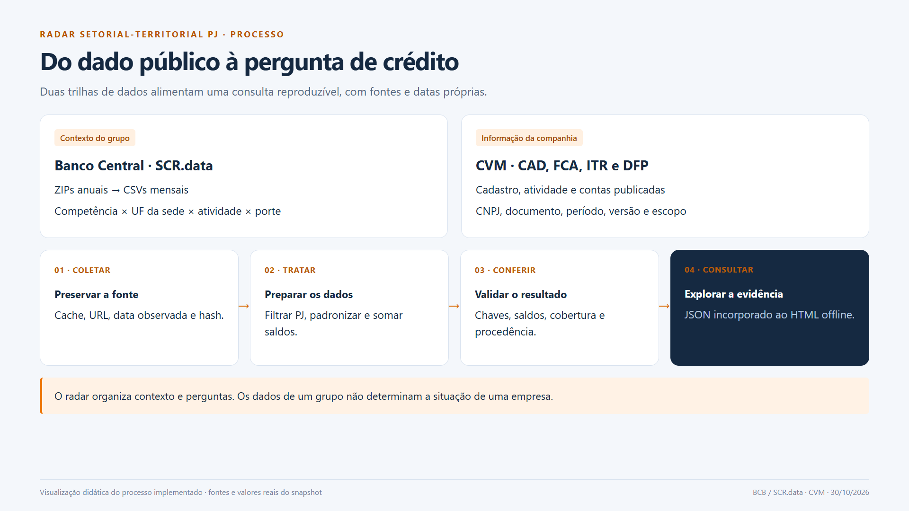

### 02 csv original

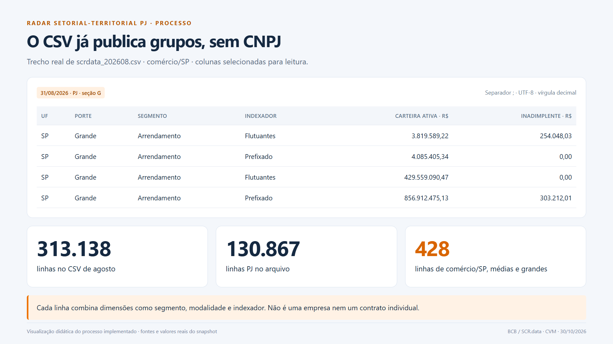

### 03 padronizacao

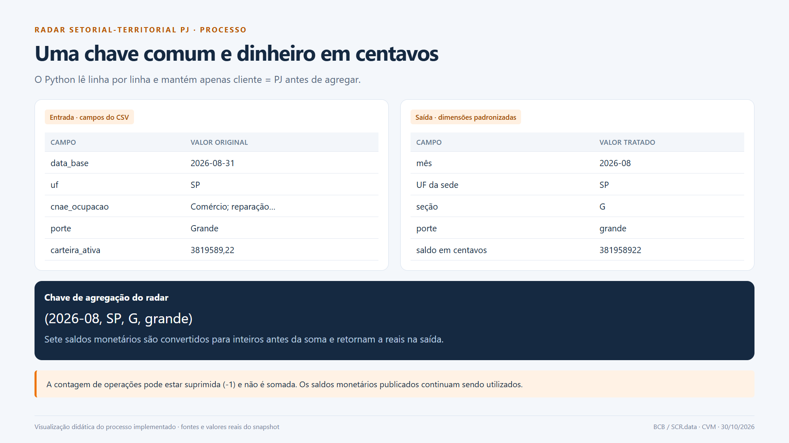

### 04 agregacao

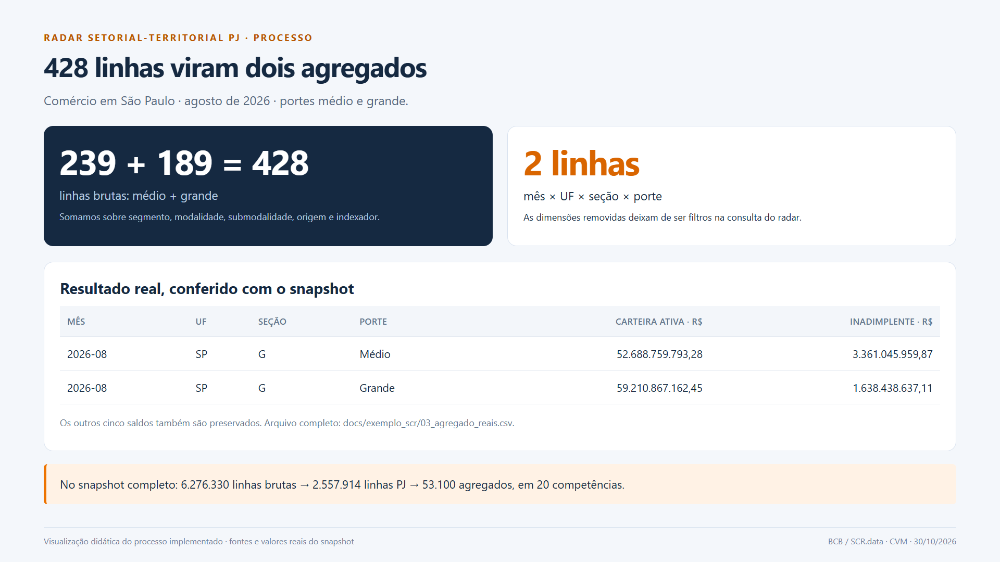

### 05 calculo gatilho

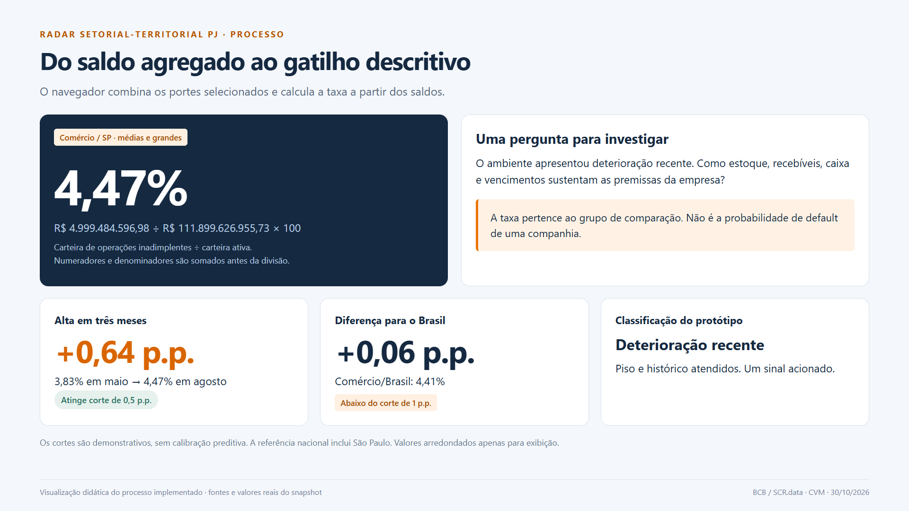

### 06 validacao

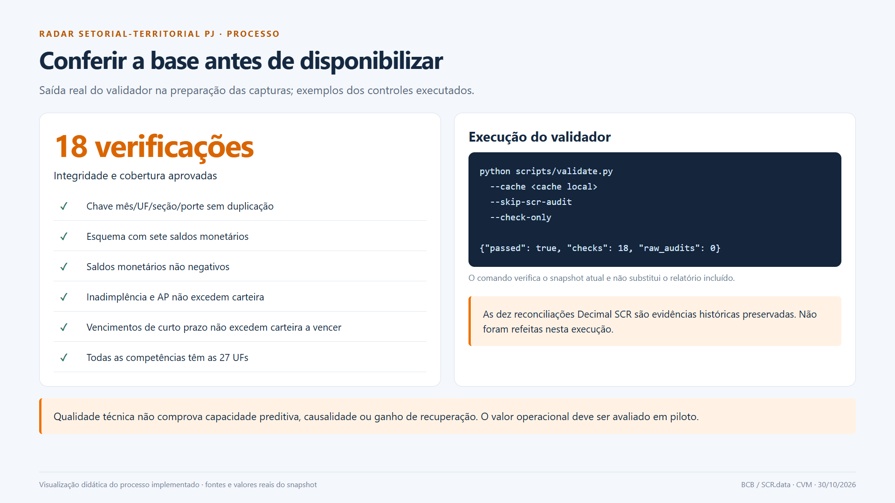

### 07 panorama

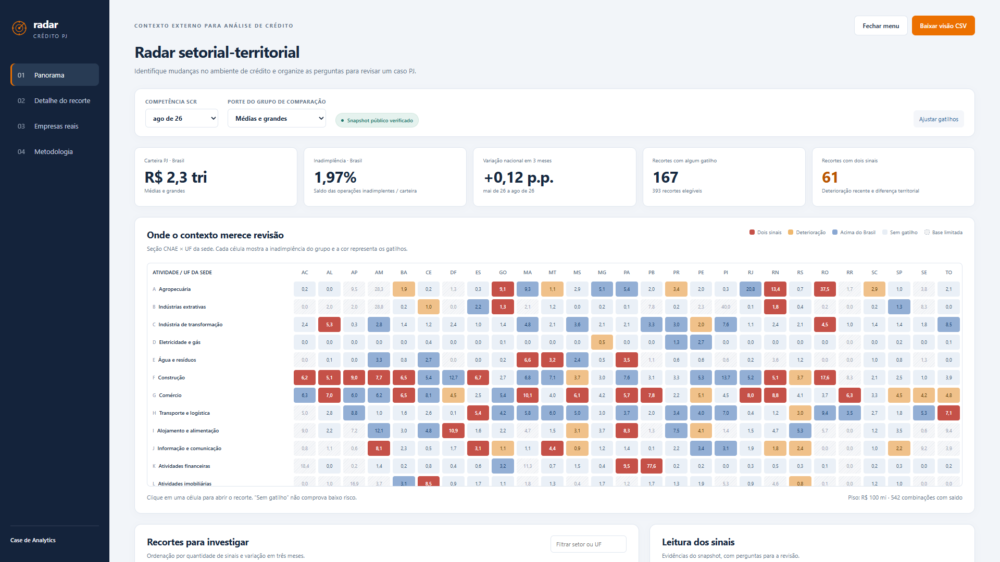

### 08 detalhe comercio sp

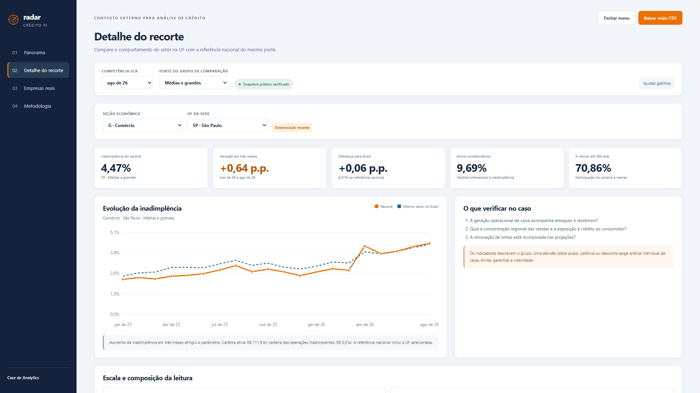

### 09 gatilhos

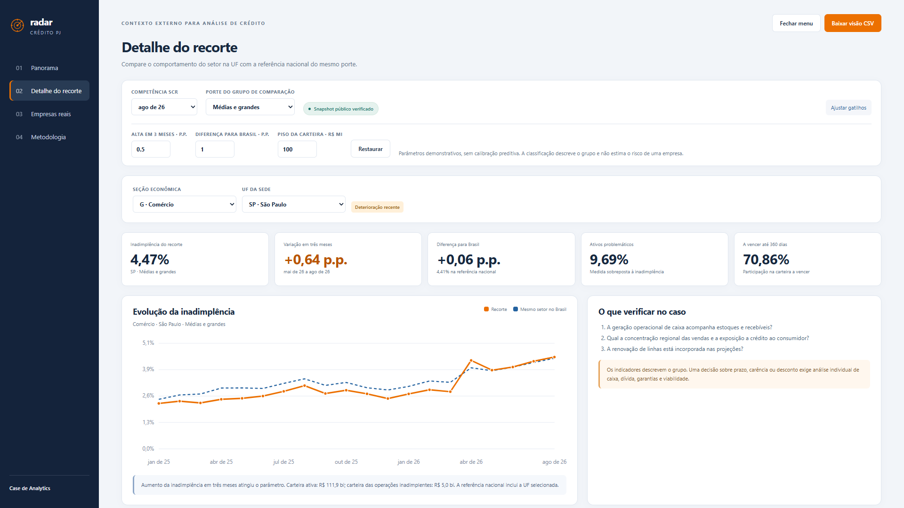

### 10 busca companhias

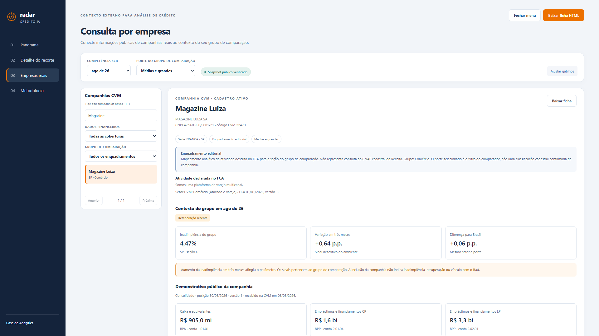

### 11 ficha empresa

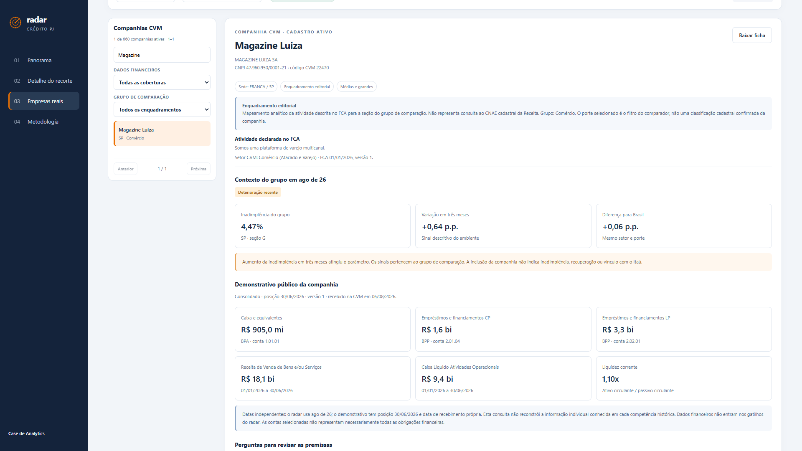

### 12 ia futura

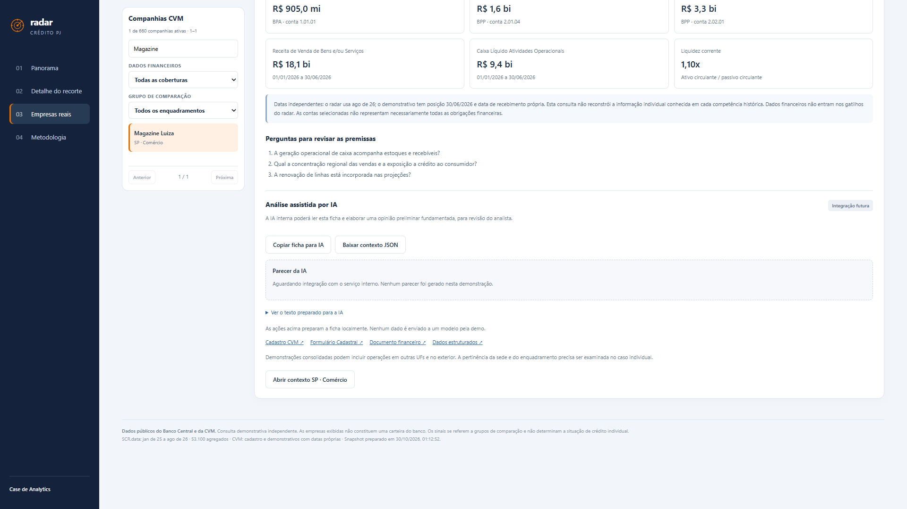

### 13 metodologia

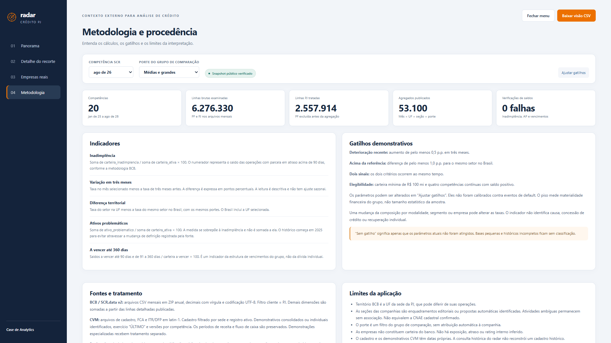
